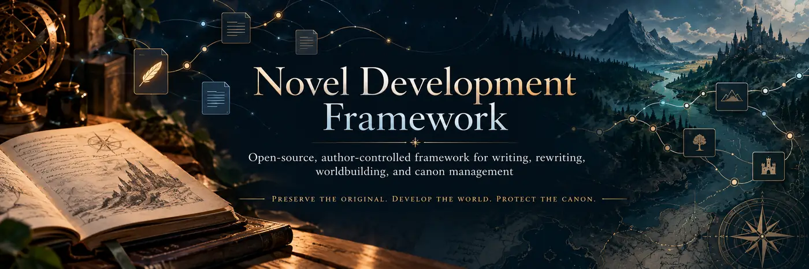

# Novel Development Framework (NDF)

**An open-source, author-controlled framework for writing novels, rebuilding manuscripts, developing fictional universes, and managing multi-book series with AI assistance.**

*Preserve the original. Develop the world. Protect the canon. Write with intention.*

## What Is Novel Development Framework?

Novel Development Framework (NDF) is a free, open-source system designed to help writers organize, develop, reconstruct, and maintain complex creative writing projects.

Whether you're beginning your first novel, rewriting a manuscript you completed years ago, or managing an interconnected series spanning multiple books, NDF provides a structured environment for developing the whole project.

Rather than treating a novel as a single document that an AI continuously generates or revises, NDF treats the entire writing project as a living creative archive. Your manuscript is only one part of that archive.

The framework manages the information behind it: your original inspiration, characters, worldbuilding, timelines, historical drafts, creative discussions, unanswered questions, approved story decisions, and revision history.

**The author remains the final creative authority. AI assists with research, organization, analysis, questioning, continuity, and drafting, but it never independently decides what becomes official canon.**

In practical terms, NDF is a collection of readable files, reusable templates, documented workflows, and optional local Python utilities. It is **not** a writing application, an AI subscription, or a hidden automation layer.

## Why Does This Exist?

Writers accumulate notes, discarded chapters, character histories, alternate plotlines, conversations, research, timelines, and revisions. Over time, important information becomes scattered across documents, folders, chats, and drafts.

AI-assisted writing introduces another challenge: an AI may unintentionally invent missing information, contradict earlier decisions, confuse tentative ideas with established facts, or gradually move a story away from the author's intentions.

NDF establishes a persistent, organized project record that both the author and AI assistants can reference throughout development. The goal is not to replace the writer, but to preserve their individual creative authority and continuity.

## Start here

Read the [Getting Started guide](docs/GETTING_STARTED.md), the [workflow](docs/WORKFLOW.md), and the [privacy guide](docs/PRIVACY.md). The [template catalog](09_Tools/README.md) lists the forms you can use.

**For your own unpublished book, create a separate private repository from the template or start from a downloaded copy. A public fork is for public work, not private manuscript storage.** This upstream repository is for the framework itself, not your private book materials.

## What it helps you organize

| Need | Framework support |
| --- | --- |
| Recover an old manuscript | Authorized source inspection, unchanged originals, provenance, and a reconstruction plan |
| Clarify an undeveloped story | Focused creator interviews, unanswered-question tracking, and intentional mysteries |
| Stop ideas becoming facts by accident | Separate evidence, AI proposals, author decisions, and explicitly approved canon |
| Manage characters and worldbuilding | Character, relationship, location, research, and timeline-event templates |
| Build the narrative | Master outline, scene registry, point-of-view knowledge, and setup/payoff tracking |
| Maintain a series | Shared canon, book-specific plans, cross-book dependencies, and retcon review |
| Revise deliberately | Continuity review, voice guidance, revision plans, beta-reader feedback, and session handoffs |
| Check the project | Offline structural validation, optional progress reports, and named-source checksums |

These are organizational aids. They do not automatically determine whether a story is coherent or whether an author actually approved a claim.

## How it works

**Preserve -> Understand -> Review -> Decide -> Plan -> Draft -> Revise**

1. **Preserve your source material.** Keep received manuscripts, notes, and conversations unchanged. An uploaded file is not automatic permission to process it. Inspection, preservation, extraction, and provenance are part of the system.
2. **Establish your intentions.** Record the book's purpose, voice, genre, narrative scale, themes, and boundaries. A historical chronicle does not have to become a conventional single-protagonist novel.
3. **Interview the author.** Build focused questions from authorized sources, prior decisions, and unresolved issues. The default is about twenty questions together, but the author can change the form or scope.
4. **Review claims before canon.** Stage source-linked claims, distinguish author statements from AI suggestions, and list contradictions. Only a separate, explicit author decision permits promotion to canon.
5. **Plan before generating major prose.** Build the outline and scene plan. An AI assistant presents a Writing Context Brief, identifies its repository branch and commit, and waits for approval of the plan before drafting large sections.
6. **Draft and revise with traceability.** Check continuity, chronology, voice, and dependencies. Keep revisions and explain significant changes. Approval of prose is not permission to publish it.

The [Constitution](00_Project/Constitution.md) and [agent instructions](AGENTS.md) define the authority boundaries. [Detailed workflows](docs/README.md) explain each stage.


## Quick start

Create your own workspace using GitHub's **Use this template** button when enabled, or **Code -> Download ZIP**. Choose private visibility for unpublished material. Fork this repository when contributing to the framework itself.

Complete [Vision](00_Project/Vision.md) and [Author Intent](00_Project/Author_Intent.md), then start a [project-initialization interview](09_Tools/Templates/Project_Initialization.md). Copy `05_Books/[...]` or use the blank book template.

```bash
python scripts/create_book.py --id BOOK-001 --title "My Novel"
# Review the preview. This second command actually creates the folder:
python scripts/create_book.py --id BOOK-001 --title "My Novel" --apply
```

Track planned scenes in [Scene_Registry.csv](04_Story/Scene_Registry.csv). Use [Plot Threads](04_Story/Plot_Threads.md) for promises and payoffs, and [Series Map](04_Story/Series_Map.md) when books share continuity.

## Optional local tools

Python 3.10 or newer is required only for the utilities. They use the standard library: no package installation, model calls, telemetry, or external service is built into them.

```bash
python scripts/validate_framework.py
python scripts/project_status.py
python scripts/project_status.py --words
python scripts/source_manifest.py "path/to/an/authorized-source.docx"
python -m unittest discover -s tests -v
```

Validation checks required files, basic local Markdown link destinations, record IDs, canon approval metadata, and the scene registry. It does not inspect inbox or archived source contents, active chapter drafts, or unpublished prose.

## Repository map

```text
00_Project/       Vision, governance, decisions, questions, and handoffs
01_Artifacts/     Source-linked recollections and recovered concepts
02_Canon/         Author-approved facts only; initially empty
03_Worldbuilding/ Non-canonical character and setting development
04_Story/         Outlines, scenes, timeline planning, plot threads, series, revisions
05_Books/         One folder per book, with a reusable blank book template
06_Research/      Referenced research, separate from fictional truth
07_Artwork/       Visual-development records and rights notes
08_Publication/   Release checklists; publication still requires authorization
09_Tools/         Templates and review checklists
_inbox/           Unprocessed incoming sources; presence is not permission
archive/          Unchanged preserved source packages and supplements
knowledge/        Atomic claim staging and specific review queues
scripts/          Optional offline utilities
tests/            Temporary-workspace tests
```

Each collection has a README. Start with the [project dashboard](00_Project/Dashboard.md) and keep the [session handoff](09_Tools/Templates/Session_Handoff.md) current when stopping work.

## Working with AI

Ask your assistant to read `AGENTS.md` and the applicable policies first. It must distinguish source material, interpretation, proposed changes, decisions, canon, and manuscript continuity. It must not silently treat rough notes as established fact.

Instructions are not a security sandbox and do not guarantee that every assistant will follow them. Review its work. A third-party assistant may send supplied content to its own service; review that service handling before trusting output or committing material.

## Contributing and license

Writers, editors, and developers are welcome to improve the framework. Read [CONTRIBUTING](CONTRIBUTING.md), [community expectations](CODE_OF_CONDUCT.md), and the [roadmap](ROADMAP.md). Submit reproducible, source-aware changes.

The framework is distributed under the [MIT License](LICENSE), which permits reuse, modification, and redistribution subject to its terms. Your independently written stories are not required to be open-source.

---

*Your story. Your canon. Your creative authority.*

